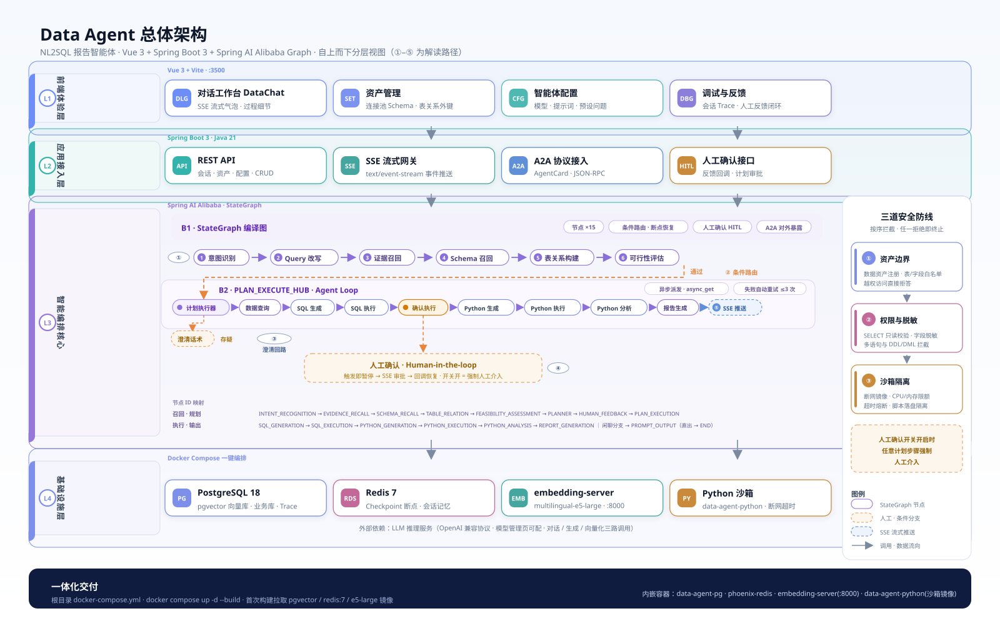
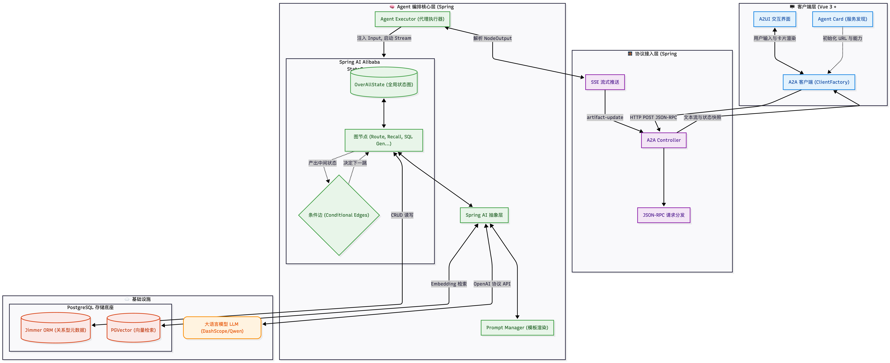

# 🚀 Data-Agent：电商经营数据智能问答系统（Text2SQL Agent）

一个基于 **Java Spring Boot + Spring AI + PostgreSQL/pgvector** 的端到端 **Text2SQL 智能体**，把自然语言问题转换成 SQL 并执行查询、自动生成报告。内置电商演示库（店铺 / 商品 / 订单 / 库存 / 退款），支持知识库检索、人工确认（HITL）、只读 SQL 安全校验、Python 沙箱分析、A2A 协议集成，全套可用 **Docker 一条命令拉起**。

> 本项目基于开源项目 `spring-ai-alibaba/DataAgent` 与 `qifan777/data-agent-tutorial` 改造而成，并补齐了 Docker 编排、Java 后端实现与本地 Embedding 服务。开源前已清理个人/API 配置，模型 Key 一律走环境变量注入。

---

## ✨ 核心功能

- **自然语言 → SQL 数据问答**：基于 13 节点的 StateGraph 编排，覆盖“证据召回 → Schema 召回 → 表关系 → 可行性评估 → 规划 → 人工确认 → SQL/Python 执行 → 报告生成”全链路。
- **双重检索（双通道 RAG）**：`pgvector(HNSW)` 向量召回表 / 列 / 业务词表 / 问答示例，叠加结构化建表与关系元数据，减少 SQL 幻觉。
- **只读安全与权限隔离**：SQL 生成后执行前强制只读校验（仅 SELECT，禁止 DROP/ALTER/DELETE/TRUNCATE/多语句）；运营仅所属店铺、客服仅单买家、手机号/地址自动脱敏。
- **人工确认（HITL）**：复杂问题在人工确认节点暂停，前端“提交人工输入”后续跑。
- **Python Docker 沙箱分析**：`SimplePythonExecutor` 通过宿主 Docker 调用独立沙箱镜像执行分析脚本。
- **流式与 Agent 互操作**：SSE 流式输出 + A2A(JSON-RPC) 协议，可作为上层客服等主 Agent 的子 Agent。
- **业务与运营管理页**：商品 / 订单 / 库存 / 退款 / 店铺管理，以及数据资产、知识库、模型管理、调试管理（火焰图/调用树）、反馈管理。
- **模型在线配置**：LLM 与 Embedding 模型可在“模型管理”页在线增删改（存数据库，不入代码）。

---

## 🧬 技术栈

| 层 | 技术 |
|----|------|
| 后端 | Java 21 · Spring Boot · Spring AI · Jimmer(ORM) |
| 图编排 | Spring AI StateGraph（条件边 + 13 节点） |
| 向量/存储 | PostgreSQL + pgvector(HNSW) · Redis · SQLite(演示库) |
| 前端 | Vue 3 · TypeScript · Vite · Element Plus |
| 模型 | ChatModel（OpenAI 兼容中转，默认 deepseek 系）+ Embedding(`intfloat/multilingual-e5-large`) |
| Embedding 服务 | 本地 FastAPI(embedding-server, :8000) |
| 集成 | A2A(JSON-RPC) · SSE 流式 |
| 部署 | Docker Compose（6 个容器一键拉起） |

---

## 🏗️ 架构图



A2A 客户端/服务端集成示意：



> 生成原始 SVG 的脚本见 `data-agent-frontend/public/__diag/gen.mjs`（诊断用，已 gitignore）。

---

## 📁 项目目录结构

```
data-agent-tutorial/
├── data-agent-backend-java/          # Java Spring Boot 后端 (:9933)
│   ├── src/main/java/.../server/     # 业务模块
│   │   ├── agent/                    # StateGraph 编排：节点/边/提示词
│   │   ├── asset/                    # 数据资产 / schema 摘要接口
│   │   ├── dataset/                  # 表/列元数据 + 知识 + 启动时 schema 入库
│   │   ├── mall/                     # 电商业务：商品/订单/库存/退款 CRUD
│   │   ├── kb/                       # 知识库管理（问答示例/词表/口径）
│   │   ├── model/                    # 模型（LLM + Embedding）在线配置
│   │   ├── security/                 # 只读 SQL 校验 + 权限拦截 + 脱敏
│   │   ├── trace/                    # 节点级 trace（火焰图/调用树）
│   │   └── integration/a2a/          # A2A(JSON-RPC) 集成
│   ├── src/main/resources/
│   │   ├── application.yml           # 数据源/模型/向量库配置（Key 走环境变量）
│   │   ├── dev_20240627/             # 演示 SQLite：业务表 + 知识库 seed
│   │   └── prompts/*.st              # 各节点提示词模板
│   ├── python-sandbox/               # Python 分析沙箱（Docker 镜像）
│   ├── Dockerfile
│   └── pom.xml
├── data-agent-frontend/              # Vue3 + TS + Vite 前端 (Docker :8080)
│   ├── src/views/                    # 数据问答/订单/商品/库存/退款/知识库/调试/模型管理
│   ├── src/api · components · router · stores
│   ├── Dockerfile + nginx.conf
├── embedding-server/                 # 本地 Embedding 服务 (:8000, e5-large)
├── docs/                             # 架构设计/提示词/SQL安全/数据源/生产规范 + 演讲讲稿
├── assets/readme/                    # README 配图
├── docker-compose.yml                # 一键编排（PG/Redis/Embedding/沙箱/后端/前端）
├── database.sql                      # PostgreSQL 初始化 dump（元数据+知识+示例）
└── README.md
```

---

## 🚀 快速开始（Docker 一键）

**前置条件**：已安装 Docker 与 Docker Compose（建议 Docker Desktop / Linux 引擎 24+，并能访问外网拉取镜像）。

1. 进入项目目录，创建模型配置文件 `.env`（否则使用占位 Key，问答无法正常调用模型）：

```bash
cd data-agent-tutorial
# 在 .env 中填写你的中转站/模型地址与 Key
OPENAI_BASE_URL=https://你的模型中转地址
OPENAI_API_KEY=你的Key
```

2. 构建并启动全部服务（首次会拉镜像 + 初始化数据库，耗时较长）：

```bash
docker compose up -d --build
```

3. 访问前端：<http://localhost:8080>；后端 API：<http://localhost:9933>。

**常用命令**：

```bash
docker compose ps            # 查看各服务健康状态
docker compose logs -f backend   # 看后端日志
docker compose down          # 停止但不删数据
docker compose down -v       # 停止并清空数据卷（重建演示数据）
docker compose build         # 重新构建镜像
```

> 仅运行 Python 分析沙箱（后端通过宿主 Docker 调用）时启动对应 profile：`docker compose --profile sandbox up -d python-sandbox`。

---

## ⚙️ 配置说明

**后端主要配置**（`data-agent-backend-java/src/main/resources/application.yml`，生产请用环境变量覆盖）：

| 配置项 | 说明 | 默认值 |
|--------|------|--------|
| `spring.datasource.url` | PostgreSQL 连接串 | `jdbc:postgresql://localhost:5432/data_agent_tutorial` |
| `spring.ai.openai.base-url` | 模型中转地址 | `${OPENAI_BASE_URL:https://api.openai.com}` |
| `spring.ai.openai.api-key` | 模型 Key（勿硬编码） | `${OPENAI_API_KEY:}` |
| `spring.ai.openai.embedding.base-url` | Embedding 服务地址 | `http://localhost:8000` |
| `server.port` | 后端端口 | `9933` |

**Docker Compose 环境变量**（`.env` 覆盖）：

| 变量 | 说明 | 默认 |
|------|------|------|
| `OPENAI_BASE_URL` | 模型中转地址 | `https://api.openai.com` |
| `OPENAI_API_KEY` | 模型 Key | `sk-placeholder` |

**端口一览**：

| 端口 | 服务 |
|------|------|
| `8080` | 前端（Nginx） |
| `9933` | 后端 API |
| `5432` | PostgreSQL（pgvector） |
| `8000` | Embedding 服务 |
| `6379` | Redis |

**本地开发（非 Docker）**：后端 `mvn spring-boot:run`（需先启动 PG + Embedding + Redis），前端 `pnpm install && pnpm dev`（Vite 默认端口，代理已配置到后端）。

---

## 🗄️ 数据与模拟数据

- **业务模拟数据**：`data-agent-backend-java/src/main/resources/dev_20240627/dev_databases/ecommerce_ops/ecommerce_ops.sqlite` —— 店铺 / 商品 / 订单 / 买家 / 退款 / 活动等电商业务表。
- **知识库数据**：`data-agent-backend-java/src/main/resources/dev_20240627/knowledge_base.sqlite` —— 业务词表 / 指标口径 / 问答示例。
- **PostgreSQL 初始化 dump**：`database.sql` —— agent 元数据表（`db_table` / `db_column` / `db_foreign_key` / `glossary_knowledge` / `question_knowledge` / `vector_store`）。
- 以上 seed 数据会随项目一起发布；运行期 `data-agent-backend-java/data/` 下的 sqlite 副本与 trace 为程序自动生成，不入版本库。启动后端时 `EcommerceSchemaInitializer` 会把演示库表/列/外键写入 PG 并向量化。

---

## 📚 文档与讲稿

| 文档 | 说明 |
|------|------|
| [docs/架构讲稿.html](docs/%E6%9E%B6%E6%9E%84%E8%AE%B2%E7%A8%BF.html) | 🎤 **交互式架构演讲讲稿（浏览器打开）** |
| [docs/讲稿-数据Agent架构与实现.md](docs/%E8%AE%B2%E7%A8%BF-%E6%95%B0%E6%8D%AEAgent%E6%9E%B6%E6%9E%84%E4%B8%8E%E5%AE%9E%E7%8E%B0.md) | 文字版架构与实现讲稿 |
| [docs/面试八股文-电商经营数据问答DataAgent.md](docs/%E9%9D%A2%E8%AF%95%E5%85%AB%E8%82%A1%E6%96%87-%E7%94%B5%E5%95%86%E7%BB%8F%E8%90%A5%E6%95%B0%E6%8D%AE%E9%97%AE%E7%AD%94DataAgent.md) | 🎓 配套面试八股文（项目速览/核心问答/部署细节/加分点） |
| [docs/01-架构设计-模块划分.md](docs/01-%E6%9E%B6%E6%9E%84%E8%AE%BE%E8%AE%A1-%E6%A8%A1%E5%9D%97%E5%88%92%E5%88%86.md) | 整体架构与模块划分、数据流 |
| [docs/02-系统提示词.md](docs/02-%E7%B3%BB%E7%BB%9F%E6%8F%90%E7%A4%BA%E8%AF%8D.md) | 各节点系统提示词说明 |
| [docs/03-FunctionCall定义.json.md](docs/03-FunctionCall%E5%AE%9A%E4%B9%89.json.md) | FunctionCall 定义 |
| [docs/04-SQL安全与权限代码模板.md](docs/04-SQL%E5%AE%89%E5%85%A8%E4%B8%8E%E6%9D%83%E9%99%90%E4%BB%A3%E7%A0%81%E6%A8%A1%E6%9D%BF.md) | SQL 只读校验与权限/脱敏模板 |
| [docs/05-数据源对接规范.md](docs/05-%E6%95%B0%E6%8D%AE%E6%BA%90%E5%AF%B9%E6%8E%A5%E8%A7%84%E8%8C%83.md) | MySQL / 数据中台 API 接入规范 |
| [docs/06-测试与生产安全差异化.md](docs/06-%E6%B5%8B%E8%AF%95%E4%B8%8E%E7%94%9F%E4%BA%A7%E5%AE%89%E5%85%A8%E5%B7%AE%E5%BC%82%E5%8C%96.md) | 测试/生产安全差异与生产增强建议 |

> 💡 架构图源文件位于 `docs/diagrams/`（`architecture.svg`、`topology.svg` 等）。

---

## 📄 开源与致谢

本项目基于以下开源项目改造，感谢原作者的优秀工作；发布与二次开发请遵守原作者的开源许可证并保留署名：

- [`qifan777/data-agent-tutorial`](https://github.com/qifan777/data-agent-tutorial)
- [`spring-ai-alibaba/DataAgent`](https://github.com/spring-ai-alibaba/DataAgent)

发布前已移除个人配置与 API Key（统一走 `.env` / 环境变量），并清理了运行期调试产物。若发现遗漏的敏感信息，欢迎提 Issue 反馈。
